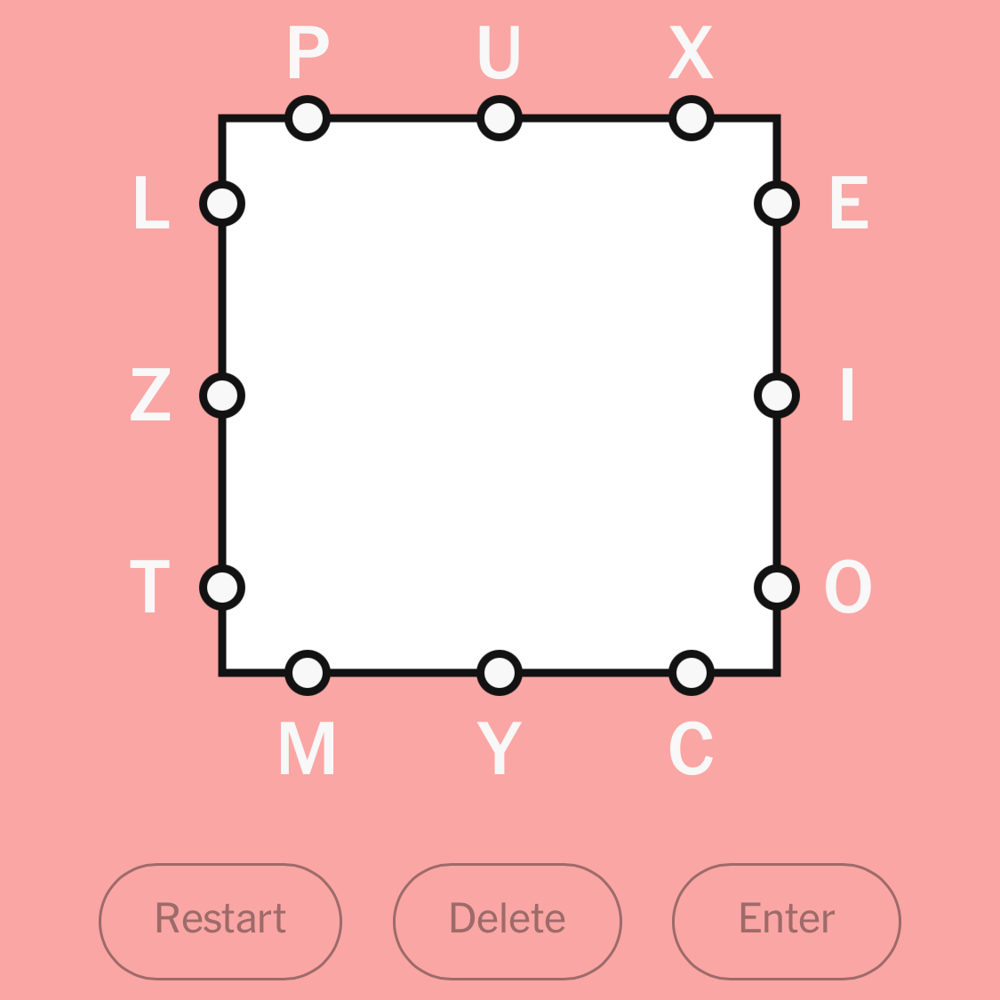
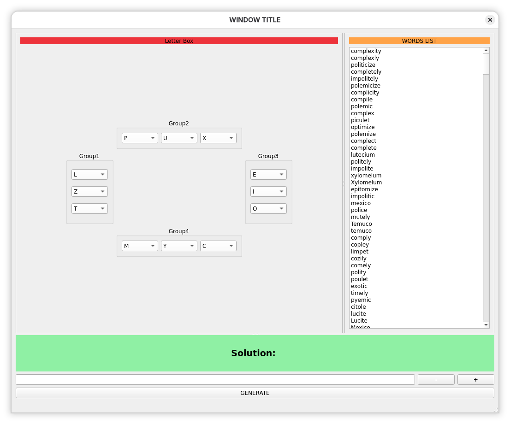
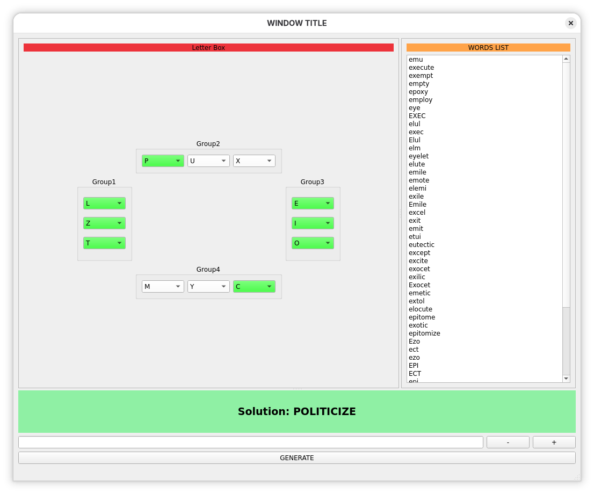
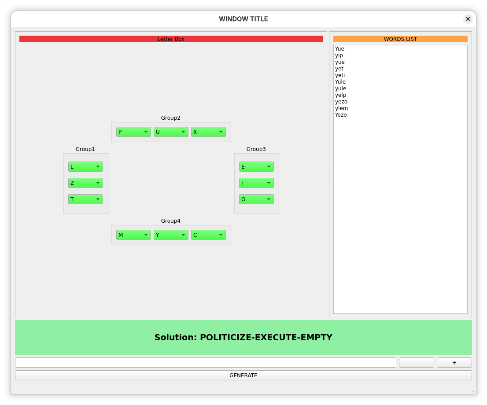

# letterBoxApp
***

Application that uses a local word database to help solve the NYT letter box game. I struggled to get two word answers so for fun i programed something to help quickly generate answers.

All you need to do is select the letters for the game click generate and a word list will appear. Then you can add words to the solution by double clicking them and the word selection will update each time displaying only the relevant words.

## Game Example:

**Generating A Solution:**

Select the correct letters for each group and click generate.

Then double click on a word you want to put in the solution.

*Note you can remove a word by clicking the minus button or add a word not in the database by entering it and pressing the plus button.*

*Note once all letters are highlighted in green you have reached a solution.*

## Database Files

> ***wordnet20-from-prolog-all-3.sql***

This is the original wordnet database file can be run to create the original database.

> ***wordnet.sql***

This is a sql file to add just the words to a table named eng_dictionary. The table must exist before running this.

>  ***wordgame.sql***

Second word source sql file to add additional words to eng_dictionary table